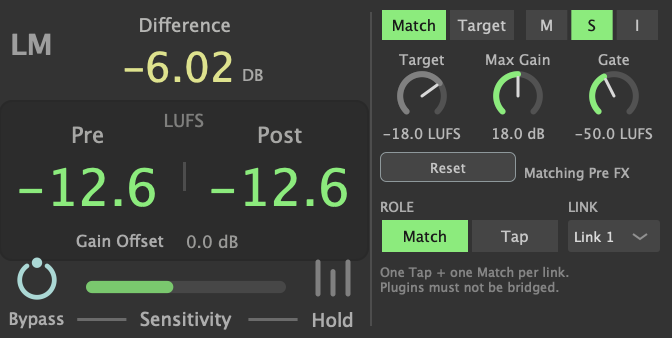

# LUFS Match (VST3 / AU)

Versión plugin del dispositivo Max for Live **LUFS Match**, para FL Studio u otro DAW.
Iguala la sonoridad de lo que sale de tus efectos con la de lo que entraba (BS.1770 / EBU R128),
o la lleva a un objetivo en LUFS. Mismo DSP, misma interfaz.

El build lo instala en `/Volumes/X9 Pro/Library/Audio/Plug-Ins/VST3` y `.../Components`
(universal: Apple Silicon + Intel; la carpeta se cambia con `-DLM_PLUGIN_DIR=...`). Como el resto
de tus plugins del X9 Pro, se expone a macOS con symlinks en `/Library/Audio/Plug-Ins`:

```bash
ln -s "/Volumes/X9 Pro/Library/Audio/Plug-Ins/VST3/LUFS Match.vst3" "/Library/Audio/Plug-Ins/VST3/"
sudo ln -s "/Volumes/X9 Pro/Library/Audio/Plug-Ins/Components/LUFS Match.component" "/Library/Audio/Plug-Ins/Components/"
```

El AU solo se registra desde `/Library` o `~/Library`, así que sin el segundo link no aparece.
Con el disco desmontado, ninguno de los dos carga.



## Por qué son dos instancias

En Live el dispositivo escucha el punto *Pre FX* de su propia pista. En FL Studio un plugin no
puede hacer eso (el sidechain de FL solo trae audio de *otra* pista del mixer), así que se usa un
par en la misma pista:

- **Tap** (Role: Tap), **primero** en la cadena: copia el audio original, no lo modifica.
- **Match** (Role: Match), **último** en la cadena: mide los dos y aplica la ganancia.

Los dos tienen que estar en el **mismo Link** (1–16). Para otra pista, usá otro Link.

## En FL Studio

1. Si no aparece en la lista: *Options → Manage plugins → Find installed plugins*
   (FL ya busca en la carpeta VST3 estándar). Marcalo como favorito si querés.
2. En la pista del mixer: slot 1 → **LUFS Match**, poné **Role: Tap**.
3. Tus efectos en los slots del medio.
4. Último slot → **LUFS Match**, **Role: Match**, mismo Link.
5. Reproducí: *Difference* muestra la corrección; *Pre* y *Post* en LUFS (Post verde cuando ya se
   asentó). El botón de power (Bypass) hace el A/B contra el original a igual volumen.

No uses "Make bridged" en el wrapper de FL para estos plugins: el enlace funciona dentro del
mismo proceso. El estado avisa "No Tap on link N" o "Two Taps on link N" si algo está mal armado.
El modo **Target** no necesita Tap.

## Controles

Los mismos que en Max for Live: Bypass (A/B), Sensitivity (velocidad), Hold (se guarda con el
proyecto), Gain Offset, Match/Target, ventana M/S/I (0.4 s, 3 s, integrada con compuertas),
Target, Max Gain, Gate y Reset (también se reinicia al darle Play). Todos son automatizables
menos Reset.

## Compilar

```bash
python3 -m venv .venv && .venv/bin/pip install cmake ninja
git clone --depth 1 --branch 8.0.15 https://github.com/juce-framework/JUCE.git JUCE
PATH="$PWD/.venv/bin:$PATH" cmake -S . -B build -G Ninja -DCMAKE_BUILD_TYPE=Release
PATH="$PWD/.venv/bin:$PATH" cmake --build build
```

El build instala el VST3 y el AU. Pruebas:

- `tests/engine_test.cpp`: DSP solo (casos EBU, match, target, gating, hold, rango).
- `build/LMHostTest_artefacts/Release/LMHostTest <plugin>`: carga el VST3/AU real como Tap + Match
  con un efecto de +6 dB en el medio.
- `build/LMSnapshot_artefacts/Release/LMSnapshot a.png b.png`: renderiza la interfaz.

## Licencia

AGPLv3 (ver `LICENSE`), compatible con la licencia AGPLv3 de JUCE 8. Podés usar, modificar y
redistribuir el plugin; si distribuís una versión modificada, tenés que publicar su código
bajo la misma licencia.
